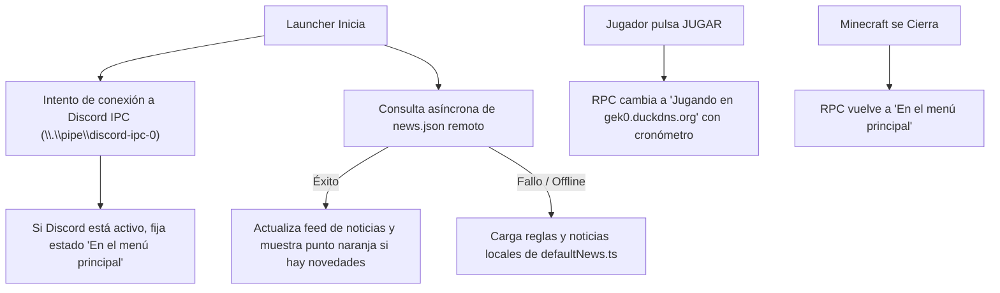

# Especificación de Diseño: Discord Rich Presence y Panel de Noticias del Evento

**Fecha:** 2026-10-13  
**Estado:** Propuesto / Aprobado preliminarmente  
**Subsistema:** Difusión en Comunidad y Panel de Eventos (Fase 2)

---

## 1. Resumen Ejecutivo y Propósito
Este subsistema tiene como objetivo enriquecer la experiencia de la comunidad y la visibilidad del servidor *MonoEvents: Noche de Sangre* mediante:
1. **Discord Rich Presence (RPC) Nativo:** Mostrar en el perfil de Discord de los jugadores su actividad en tiempo real, alternando automáticamente entre el estado en el launcher y el estado en partida dentro del servidor `gek0.duckdns.org` con contador de tiempo de juego.
2. **Panel de Noticias, Reglas y Horarios:** Un centro informativo dinámico integrado en el launcher que consulta novedades remotas vía JSON con respaldo local garantizado, permitiendo al staff comunicar anuncios y reglas sin lanzar actualizaciones del ejecutable.

---

## 2. Flujo de Usuario y Comportamiento



---

## 3. Arquitectura del Backend: Discord RPC (Rust / Tauri)

### 3.1. Conexión IPC Nativa (`discord/rpc.rs`)
- Se conecta a la tubería con nombre de Discord (`\\.\pipe\discord-ipc-0` hasta `discord-ipc-9` en Windows).
- **Handshake (Opcode 0):** Envía `{"v": 1, "client_id": "1295058726597791836"}` (ID de aplicación oficial de Discord para MonoEvents).
- **Envío de Actividad (Opcode 1):**
  - **En Launcher:**
    - *Details:* `En el menú principal`
    - *State:* `MonoEvents • Noche de Sangre`
    - *Assets:* `large_image: "blood_moon"`, `large_text: "MonoEvents: Noche de Sangre"`
  - **En Partida:**
    - *Details:* `Jugando en gek0.duckdns.org`
    - *State:* `Noche de Sangre (79 mods)`
    - *Timestamps:* `start: <unix_seconds>` (cronómetro en vivo)
    - *Assets:* `large_image: "blood_moon"`, `small_image: "forge"`, `small_text: "Forge 1.20.1"`
- **Tolerancia a Fallos:** Si Discord no está abierto, el cliente pasa a estado inactivo de forma silenciosa e intenta reconectar periódicamente en segundo plano sin bloquear el arranque del launcher.
- **Interruptor en Ajustes:** Añade el campo `enable_discord_rpc: bool` (por defecto `true`) a `UserSettings`.

---

## 4. Arquitectura del Frontend: Panel de Noticias y Reglas

### 4.1. Datos y Fallback (`src/data/defaultNews.ts` y `src/stores/newsStore.ts`)
- **Estructura de datos (`types/launcher.ts`):**
  ```ts
  export interface NewsArticle {
    id: string;
    tag: 'EVENTO' | 'ACTUALIZACIÓN' | 'REGLAS' | 'AVISO';
    date: string;
    title: string;
    content: string;
    author: string;
  }

  export interface EventScheduleItem {
    time: string;
    title: string;
    type: 'airdrop' | 'roulette' | 'pvp';
  }

  export interface EventFeed {
    event_title: string;
    banner_alert?: string;
    articles: NewsArticle[];
    schedule: EventScheduleItem[];
  }
  ```
- **Store Zustand (`newsStore.ts`):**
  - `feed: EventFeed`
  - `unreadCount: number`
  - `isModalOpen: boolean`
  - `fetchRemoteNews()`: Realiza `fetch` con timeout hacia el repositorio oficial. Si falla, recurre a `defaultNews`.
  - Guarda en `localStorage` el ID del último artículo leído para calcular `unreadCount`.

### 4.2. Componente `EventNewsModal.tsx`
- **Pestaña Novedades:** Tarjetas con fecha, autor, badge de categoría y contenido formateado.
- **Pestaña Reglas:** Secciones desplegables sobre PVP en Noche de Sangre, airdrops, ruletas y proximidad de voz.
- **Pestaña Horarios:** Lista visual de eventos diarios con iconos temáticos.
- **Acceso:** Botón con icono `<Bell className="w-4 h-4" />` en la cabecera superior con insignia naranja animada si `unreadCount > 0`.

---

## 5. Criterios de Aceptación y Pruebas
1. **Discord RPC:** Al abrir el launcher con Discord en ejecución, el perfil de Discord muestra la presencia de MonoEvents. Al iniciar Minecraft, el estado cambia a la IP y cronómetro.
2. **Ajuste de Privacidad:** Si el usuario desmarca «Activar Discord Rich Presence» en Ajustes, la presencia se elimina inmediatamente.
3. **Resiliencia de Noticias:** Si se desconecta la red o falla el servidor remoto, el launcher muestra las reglas y noticias predeterminadas de forma instantánea sin mostrar pantallas de carga infinitas.
4. **Builds Limpios:** 30+ pruebas unitarias de Rust pasando (`cargo test`) y compilación de Vite sin errores (`npm run build`).
