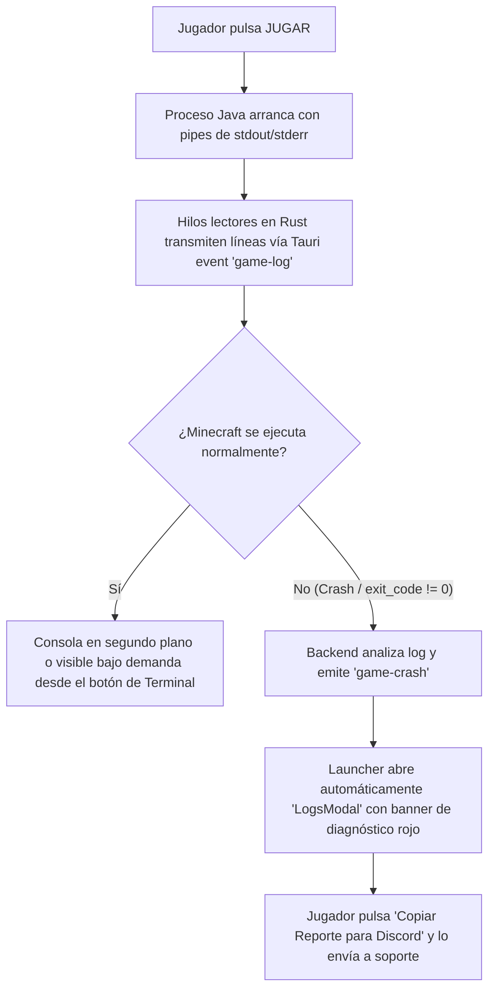

# Especificación de Diseño: Consola de Logs en Tiempo Real y Crash Reporter

**Fecha:** 2026-10-13  
**Estado:** Propuesto / Aprobado preliminarmente  
**Subsistema:** Monitoreo de Procesos, Diagnóstico de Fallos y Soporte (Fase 1)

---

## 1. Resumen Ejecutivo y Propósito
El objetivo de este subsistema es proporcionar una herramienta integral de diagnóstico en tiempo real para el cliente de Minecraft en el launcher de MonoEvents (*Noche de Sangre*). Permite a los jugadores:
1. Monitorear la carga de Forge 1.20.1 y sus 79 mods en tiempo real mediante una consola de logs visual e intuitiva.
2. Identificar instantáneamente fallos comunes de arranque o de juego (OutOfMemory, errores de drivers OpenGL, mods corruptos o versiones incorrectas de Java) mediante un motor inteligente de diagnóstico.
3. Copiar con un solo clic un reporte de error sanitizado (libre de rutas o datos personales) optimizado para el canal de `#soporte-tecnico` de Discord.

---

## 2. Flujo de Usuario y Comportamiento



### Modos de Visualización:
- **Modo Silencioso / Automático (Por defecto):** Durante una sesión normal de juego, la consola se mantiene oculta para una experiencia limpia y cinemática.
- **Apertura por Fallo:** Si el proceso de Minecraft termina con código de salida distinto de 0 (`exit_code != 0`), la consola de logs se abre automáticamente en primer plano destacando el motivo detectado y la solución sugerida.
- **Apertura Manual:** Un botón con icono `<Terminal />` en la cabecera superior permite al usuario inspeccionar los logs en cualquier momento mientras el juego carga o se ejecuta.

---

## 3. Arquitectura del Backend (Rust / Tauri)

### 3.1. Captura Asíncrona de Logs (`game/process_spawner.rs`)
Actualmente, `spawn_minecraft_process` inicia el comando de Java sin redirigir pipes. Se actualizará para:
1. Configurar `stdout(Stdio::piped())` y `stderr(Stdio::piped())`.
2. Lanzar dos hilos de lectura dedicados (`std::thread::spawn`):
   - Cada hilo utiliza `BufReader::lines()` para leer de forma continua y eficiente.
   - Cada línea leída se emite a la ventana de Tauri mediante `app.emit("game-log", log_entry)`.
   - Se mantiene un búfer circular en memoria (*ring buffer* de 200 líneas) para retener las últimas entradas en caso de terminación abrupta.
3. El hilo de supervisión espera a que el proceso termine (`child.wait()`):
   - Si `exit_status.success()`, se emite `app.emit("game-stopped", 0)`.
   - Si `!exit_status.success()`, se obtiene el código de salida y se ejecuta el motor de diagnóstico `analyze_crash_log(&recent_lines, exit_code)`. Se emite `app.emit("game-crash", crash_report)`.

### 3.2. Motor de Diagnóstico Inteligente (`game/diagnostics.rs`)
Analiza los registros de texto y códigos de salida para deducir problemas frecuentes:

| Patrón en Log / Código | Causa Raíz Detectada | Solución Recomendada para el Jugador |
|---|---|---|
| `java.lang.OutOfMemoryError` o `Java heap space` | Memoria RAM insuficiente asignada al juego | Abrir Ajustes ⚙️ y aumentar la memoria RAM a 6 GB u 8 GB. |
| `GLFW error 65542` o `Pixel format not accelerated` | Controlador gráfico desactualizado o GPU integrada sin soporte OpenGL | Actualizar drivers de tarjeta gráfica o forzar GPU de alto rendimiento en Windows. |
| `UnsupportedClassVersionError` | Incompatibilidad de versión de Java | Instalar y seleccionar Java 17 (requerido para Forge 1.20.1). |
| `DuplicateModsFoundException` | Mods duplicados en la carpeta de instalación | Eliminar archivos duplicados o volver a sincronizar el modpack. |
| `ModLoadingException` o `ClassNotFoundException` | Fallo de carga en mod específico | Revisa el mod reportado o reinstala mediante la comprobación de integridad. |
| Exit code `-1073740791` (0xC0000409) | Fallo en controlador NVIDIA/AMD o superposición (Discord overlay / GeForce) | Desactivar overlays de terceros y reiniciar el juego. |

### 3.3. Estructuras de Datos en Rust

```rust
#[derive(Debug, Clone, serde::Serialize, serde::Deserialize)]
pub enum LogLevel {
    Info,
    Warn,
    Error,
}

#[derive(Debug, Clone, serde::Serialize, serde::Deserialize)]
pub struct LogEntry {
    pub level: LogLevel,
    pub message: String,
    pub timestamp_ms: u64,
}

#[derive(Debug, Clone, serde::Serialize, serde::Deserialize)]
pub struct CrashDiagnostic {
    pub title: String,
    pub description: String,
    pub solution: String,
}

#[derive(Debug, Clone, serde::Serialize, serde::Deserialize)]
pub struct CrashReportEvent {
    pub exit_code: i32,
    pub diagnostic: Option<CrashDiagnostic>,
    pub tail_logs: Vec<String>,
}
```

---

## 4. Arquitectura del Frontend (React / TypeScript)

### 4.1. Store de Logs (`stores/logsStore.ts`)
Un store en Zustand gestiona el historial de logs y los filtros:
- `logs: LogEntry[]` (limitado a un máximo de 1000 líneas para optimizar memoria).
- `activeFilter: 'ALL' | 'WARN' | 'ERROR'`
- `searchTerm: string`
- `autoScroll: boolean` (se congela si el usuario scrollea hacia arriba).
- `lastCrash: CrashReportEvent | null`
- Métodos: `addLog(entry)`, `clearLogs()`, `setFilter()`, `setSearch()`, `setCrash()`.

### 4.2. Sanitizador y Formateador para Discord (`utils/crashReporter.ts`)
Convierte el reporte en un bloque Markdown limpio para Discord:
1. **Anonimización:** Sustituye patrones de Windows privados:
   - `C:\Users\<CualquierNombre>\` ➔ `C:\Users\***\`
   - `file:///C:/Users/<CualquierNombre>/` ➔ `file:///C:/Users/***/`
2. **Estructura generada:**
   ```markdown
   **🚨 Reporte de Fallo - MonoEvents: Noche de Sangre**
   • **Launcher:** MonoEvents v0.1.0 (Windows)
   • **Memoria Asignada:** 6 GB | Java 17
   • **Código de Salida:** 1
   • **Diagnóstico:** ⚠️ Memoria RAM agotada (Java Heap Space)
   • **Solución Sugerida:** Abre Ajustes ⚙️ y asigna 8 GB de memoria RAM.

   **Últimas líneas del registro:**
   ```yaml
   [16:14:02] [Render thread/INFO]: Loading Minecraft 1.20.1 with Forge 47.4.22
   [16:14:15] [Render thread/ERROR]: java.lang.OutOfMemoryError: Java heap space
   ```
   ```

### 4.3. Componente `LogsModal.tsx`
- **Ventana:** Modal centrado con fondo `bg-slate-950/95 backdrop-blur-2xl border border-white/10`.
- **Cabecera:** Indicador de estado del proceso (🟢 En ejecución / 🔴 Cerrado), botón de búsqueda, filtros por nivel, toggle de auto-scroll, botón de limpiar y botón de cerrar.
- **Banner de Diagnóstico:** Tarjeta destacada carmesí/naranja que solo aparece si ocurrió un crash, explicando la causa y solución.
- **Área de Texto:** Contenedor con scroll virtual o optimizado, coloreado por sintaxis:
  - Cyan / Slate: `INFO`
  - Amarillo / Ámbar: `WARN`
  - Rojo / Carmesí: `ERROR`
- **Pie de Modal:** Botón de **«Abrir archivo latest.log»** (usando `openDirectoryInExplorer`) y botón destacado **«Copiar Reporte para Discord»** con feedback de copiado.

---

## 5. Pruebas y Criterios de Aceptación
1. **Captura en Vivo:** Al pulsar «JUGAR», las líneas emitidas por Java aparecen en el store de logs en tiempo real sin congelar la interfaz.
2. **Diagnóstico Preciso:** Si se fuerza un fallo de memoria (o código de error simulado), el analizador deduce correctamente el problema y genera la sugerencia adecuada.
3. **Anonimización en Discord:** El texto copiado nunca debe contener el nombre de usuario de Windows de la máquina del jugador.
4. **Resistencia de Rendimiento:** El búfer de logs no debe superar 1000 entradas para evitar degradación de FPS en la interfaz web de Tauri.
5. **Suite de Pruebas:** Todos los tests de Rust (`cargo test`) y de Vite (`npm run build`) deben pasar con cero errores y cero advertencias críticas.
